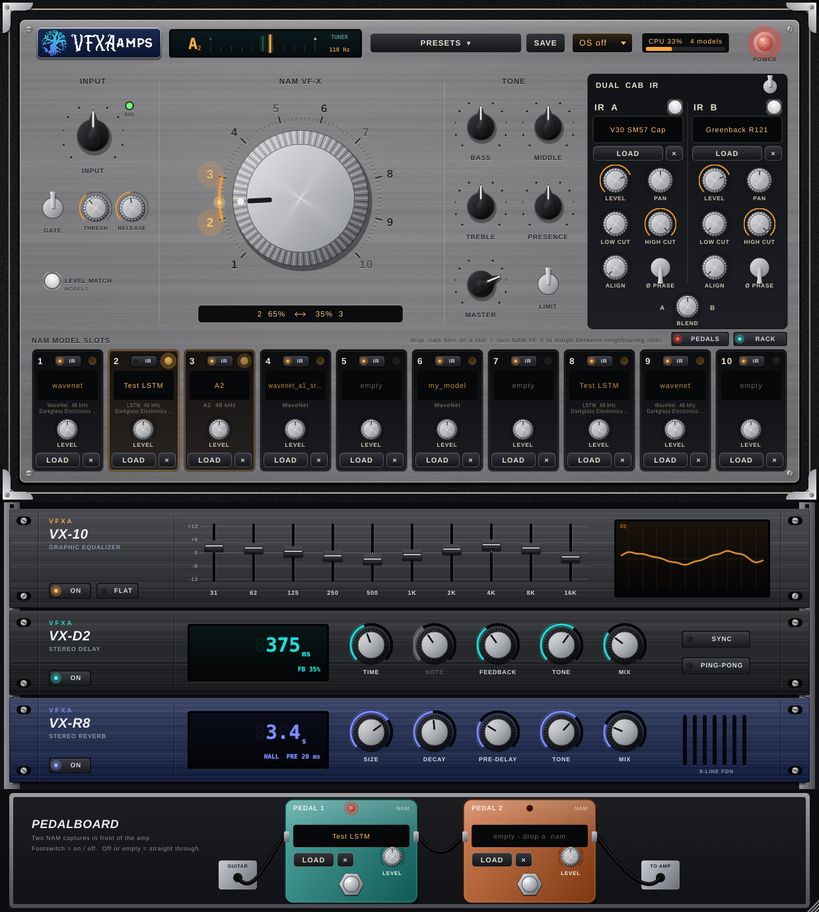

<p align="center"></p>

# VFXAamps — NAM amp head

A professional Neural Amp Modeler amp head with a **10-slot morphing gain knob** and a **dual IR loader**.
VST3, AU (macOS) and Standalone; macOS universal (Apple Silicon + Intel) and Windows x64.




## What it does

**Signal chain:** input trim → noise gate → NAM pedal 1 → NAM pedal 2 → 10-slot NAM morph → bass / middle / treble + presence → dual IR → graphic EQ → delay → reverb → master → limiter

- **Pedalboard.** Two optional NAM pedal loaders in front of the amp (drop a .nam capture of a boost, overdrive, …): footswitch,
  level, LED and name display. Off or empty, a pedal passes the guitar straight through (bit-exact). Pedal captures keep their
  own gain (no loudness matching), so a boost pushes the amp like the real thing. A pedal only runs while it holds a capture,
  so empty pedals add no latency at any sample rate. Show or hide the board with **PEDALS**.
- **The 10-slot NAM VF-X knob.** Load a `.nam` capture into each of slots 1–10 (WaveNet, LSTM, A2 / slimmable, all sizes). The big knob
  runs continuously from 1.0 to 10.0 and morphs between neighbouring slots like a real amp's gain: at 1.5 you hear an
  equal-power blend of slots 1 and 2. Empty slots are skipped (with slots 2 and 5 loaded, the knob blends 2 → 5 across that range).
  No steps, gaps or clicks, and full DAW automation.
- **Seamless by design.** Models load on a background thread and are swapped in lock-free. Only the 2–4 models that matter run:
  the two being blended plus one loaded neighbour on each side, kept "warm" so they're ready before they fade in. A model that
  becomes warm is first caught up on the input history covering its receptive field, so its state is exactly what it would be had
  it been running all along (tested sample-for-sample against always-running references: −127 dB deviation).
  Loading, clearing or big knob jumps crossfade over 40 ms.
- **Per-slot IR switch.** Each slot has an **IR** button: on, the slot plays through the dual IR (cab); off, it bypasses it — for
  captures that already include a cab (full rig). Morphing between an IR-on and an IR-off slot blends the cab in or out with
  the knob, without clicks. Loading a capture whose metadata says *amp + cab* / *full rig* turns its slot's IR off for you
  (an *amp-only* capture turns it on); reopening a session keeps your settings.
- **Per-slot level** trims, auto-normalised to each capture's loudness metadata (−18 dBFS; switch with *Level match*).
- **Sample rates.** Captures run at their trained rate (normally 48 kHz). At other host rates the engine resamples in and out with a
  windowed-sinc resampler (~1.5–1.7 ms latency, reported to the host). At 48 kHz with oversampling off, latency is **zero**.
- **Dual IR.** IR A and IR B (.wav/.aiff/.flac, any sample rate, mono or stereo): on/off, level, pan, phase invert, 0–2 ms alignment,
  low cut and high cut, A/B blend and a global IR switch. Zero-latency partitioned convolution; loading a new IR crossfades.
- **Sound quality.** 64-bit smoothing, filters, gate and limiter; double-precision host processing supported; no denormals;
  no allocations or locks on the audio thread; every parameter smoothed per sample. Optional 2×/4× oversampling for the tone stack
  and limiter.
- **Tuner** in the header, listening to your guitar input: note, a cents needle (green within ±3 cents) and the frequency.
  Accurate to about a cent from low F# on an 8-string up to C6. Click it to mute the output while you tune.
- **Effects rack** under the amp head, in rack-mount units (show or hide it with **RACK**):
  - **VX-10 graphic EQ:** 10 bands (31 Hz – 16 kHz, ±12 dB) on faders, a live response curve, FLAT to reset.
  - **VX-D2 stereo delay:** time up to 2.5 s or synced to the host tempo (1/1 … 1/16, dotted and triplet), feedback, tone,
    mix, ping-pong. Turning TIME glides like tape; switching it off lets the repeats ring out.
  - **VX-R8 stereo reverb:** 8-line feedback delay network — size (room → cathedral), decay 0.2–20 s, pre-delay, tone, mix.
    The tail rings out when switched off.
- **Amp-head UI.** Resizable, vector-drawn: tolex and brushed metal, chicken-head and knurled knobs, pilot light, a glowing ring and
  slot lamps showing which two slots are blending, CPU meter. Drag `.nam` files onto slots (several fill the following slots) and IRs
  onto IR A / B, or anywhere on the faceplate.
- **State and presets.** Session state and `.vfxapreset` files store every parameter and file. Paths are saved absolute, relative to
  your home folder and relative to the preset; files that still can't be found show up in a banner to locate (click a slot, or
  search a folder for all of them at once).

## Download

Every push builds installers in GitHub Actions (**Actions → Build VFXAamps → latest run → Artifacts**):

- `VFXAamps-macOS-installer` — a DMG: drag *VFXAamps.app* to Applications; *Install VFXAamps Plug-ins.pkg* puts the VST3 and AU in
  `/Library/Audio/Plug-Ins`.
- `VFXAamps-Windows-installer` — `VFXAamps-…-Windows-x64-Setup.exe`: VST3 into `C:\Program Files\Common Files\VST3`, plus the standalone app.

Push a version tag (`git tag v1.0.0 && git push origin v1.0.0`) to also attach both installers to a GitHub Release.

> The plug-in files are named `VFXAamps`, like the earlier VFXAamps build from the Better-Amps repository, so installing this one replaces it.
> Its plug-in ID is different (`Vfxc`/`VFXh`), so DAW sessions made with the earlier build won't load into this one.

### macOS signing (optional)

Without Apple Developer credentials the bundles are ad-hoc signed, and macOS asks for confirmation on first launch
(right-click → Open; details in the DMG's *Read Me*). To sign and notarise, add these repository secrets:

| Secret | Value |
| --- | --- |
| `MACOS_CERT_P12_BASE64` | base64 of a .p12 holding your *Developer ID Application* and *Developer ID Installer* certificates |
| `MACOS_CERT_PASSWORD` | the .p12 password |
| `MACOS_APP_SIGN_ID` | `Developer ID Application: Your Name (TEAMID)` |
| `MACOS_PKG_SIGN_ID` | `Developer ID Installer: Your Name (TEAMID)` |
| `MACOS_NOTARY_APPLE_ID`, `MACOS_NOTARY_TEAM_ID`, `MACOS_NOTARY_PASSWORD` | Apple ID, team ID and an app-specific password for `notarytool` |

The signing and notarisation steps only run when these exist.

## Build it yourself

Requirements: CMake 3.22+, a C++20 compiler (Xcode 15+ on macOS, Visual Studio 2022 on Windows), Git. JUCE 8 and Eigen are
downloaded by CMake; NeuralAmpModelerCore is a git submodule.

```bash
git clone https://github.com/vfxchris581/Vfxraman.git
cd Vfxraman
git submodule update --init
```

**macOS (universal):**

```bash
cmake -S . -B build -G Xcode -DCMAKE_OSX_ARCHITECTURES="arm64;x86_64"
cmake --build build --config Release
ctest --test-dir build -C Release --output-on-failure
installer/mac/make_installer.sh build/source/VFXAamps_artefacts/Release dist 1.0.0
```

**Windows (x64):**

```bat
cmake -S . -B build -G "Visual Studio 17 2022" -A x64
cmake --build build --config Release
ctest --test-dir build -C Release --output-on-failure
"%ProgramFiles(x86)%\Inno Setup 6\ISCC.exe" /DArtefacts=%CD%\build\source\VFXAamps_artefacts\Release /DOutputDir=%CD%\dist installer\windows\VFXAamps.iss
```

Built plug-ins are in `build/source/VFXAamps_artefacts/Release/{VST3,AU,Standalone}`.
Use `-DJUCE_DIR=…` / `-DEIGEN_DIR=…` to build against local checkouts.

## Tests

- `dsp_tests` — resampler (exact integer latency, unity gain), tone stack/gate/limiter, every example NAM architecture,
  single-slot exactness, the 10-slot morph against always-running references (sweeps + jumps), and an automation stress test
  (fast sweeps, random jumps, loading/clearing/replacing slots while playing, 44.1/48/96 kHz, random block sizes).
- `plugin_tests` — reported vs measured latency (all rates × oversampling), full chain in float and double, dual IR
  (transparency, pan, phase, alignment, cuts, blend, global bypass, swaps while playing), state/presets with relative paths and
  missing-file relinking, and an editor screenshot.

## Layout

```
  dsp/            JUCE-free DSP: morph engine (NAM), resampler, filters, dynamics
  source/         plug-in: processor, dual IR, editor and UI components
  tests/          dsp_tests.cpp, plugin_tests.cpp
  installer/      macOS DMG/pkg script, Windows Inno Setup script
  external/       NeuralAmpModelerCore (submodule)
```

Third-party: [NeuralAmpModelerCore](https://github.com/sdatkinson/NeuralAmpModelerCore) (MIT), [JUCE](https://juce.com) (AGPLv3 / commercial),
[Eigen](https://eigen.tuxfamily.org) (MPL2).
